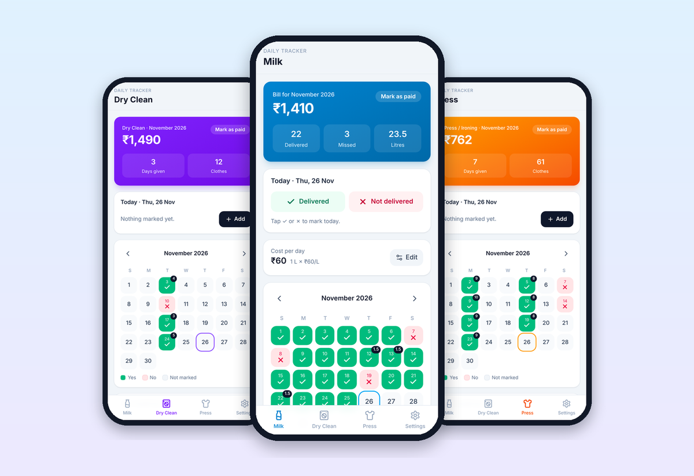
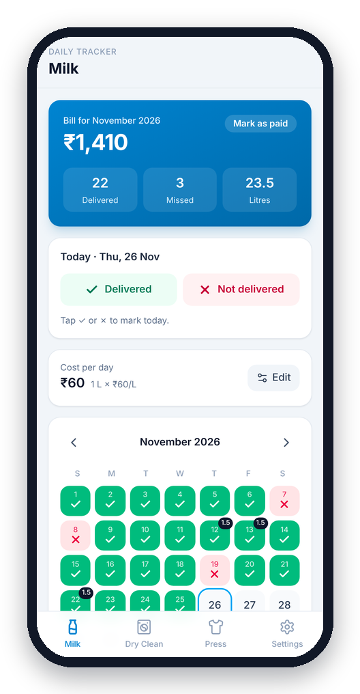
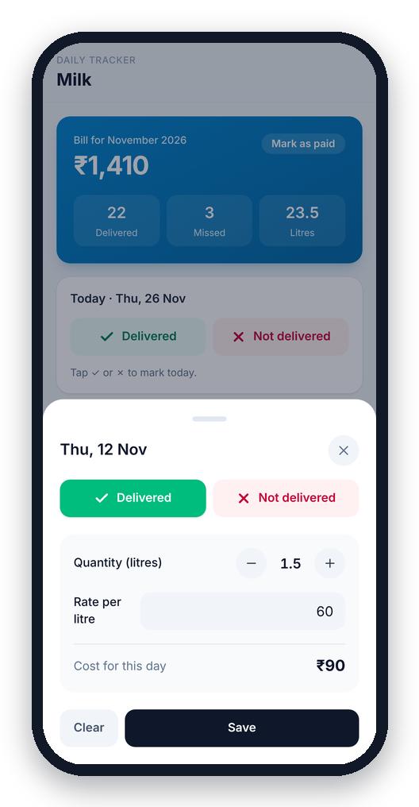
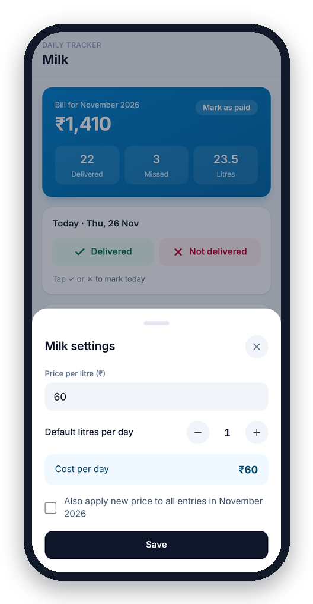
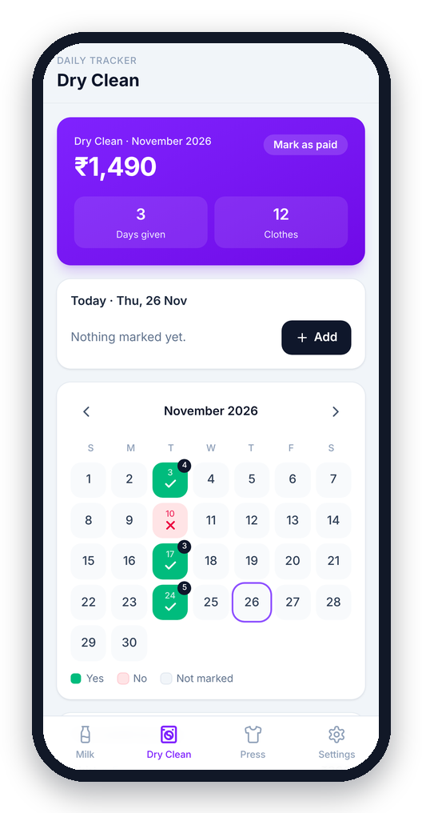
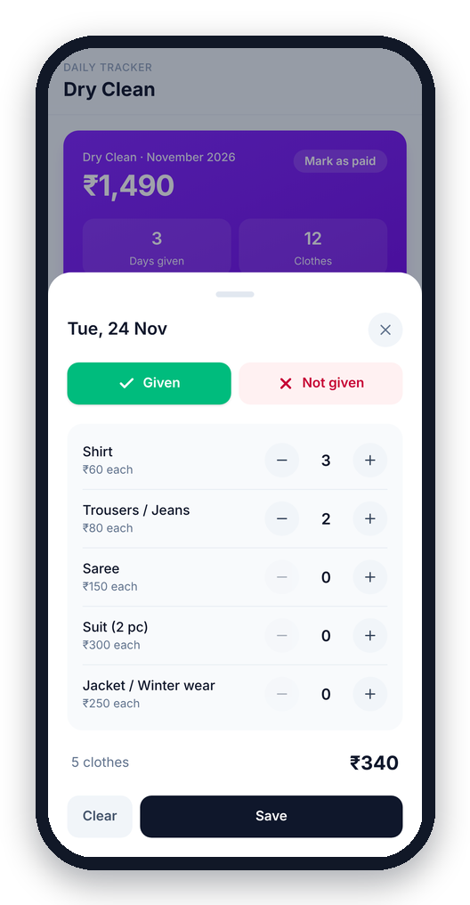
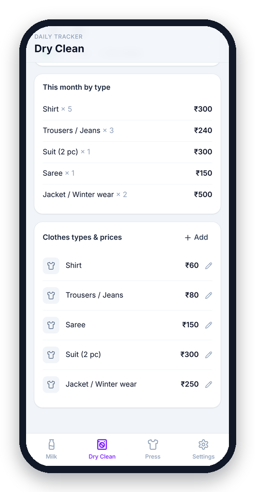
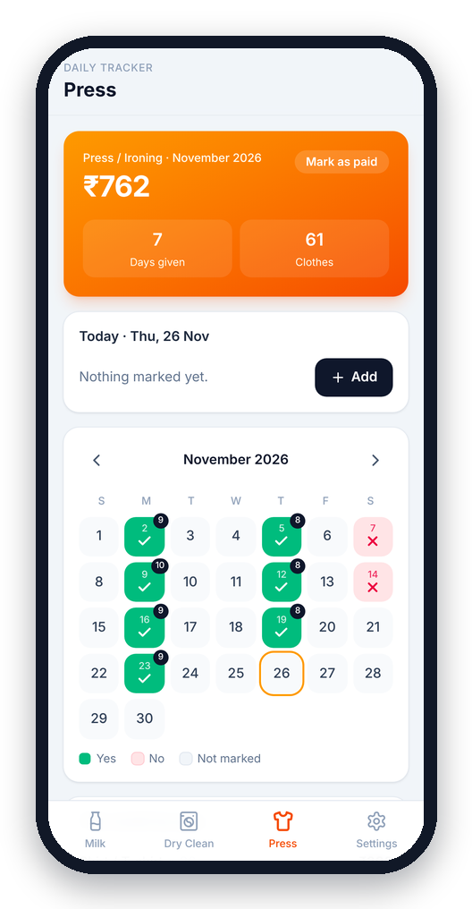
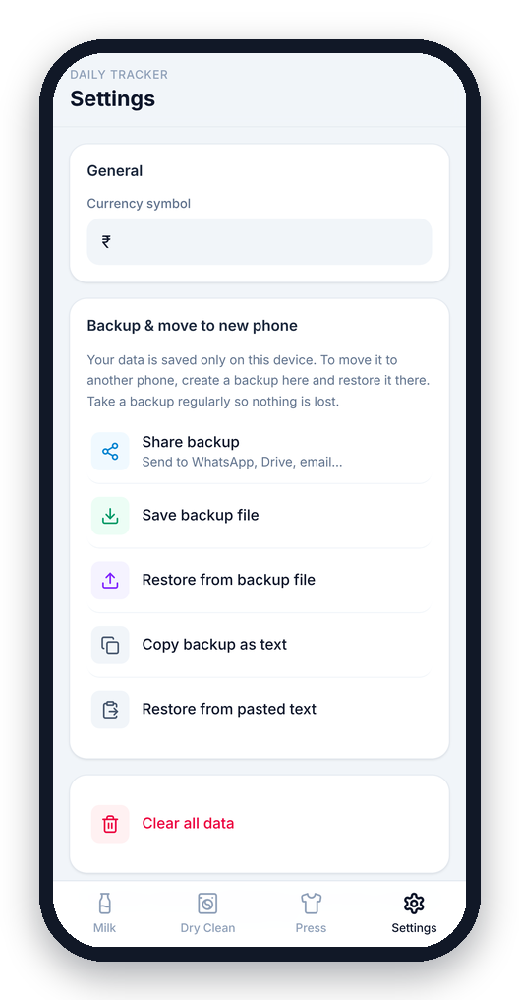

<div align="center">


# Ghar Hisaab

**Keep a clean record of your milkman, dry cleaning and ironing (press), and know exactly what you owe each month.**




</div>

---

## Why

Most households pay the milkman and the laundry/press person at the end of the month,
and there's always a question about how many days the milk didn't come, or how many shirts went for ironing last week.
Daily Tracker replaces the paper calendar on the fridge. Each day takes one tap, and the bill adds itself up.

## Demo

<div align="center">
  
</div>

## Features

### 🥛 Milk
- **Attendance-style tracking.** Mark each day ✓ *Delivered* or ✗ *Not delivered*.
- **Automatic cost.** Set the price per litre and your usual litres per day. The cost per day and the monthly bill are calculated for you.
- **Per-day changes.** Extra half litre on a festival day? Change the quantity or price for just that day.
- **Price history is kept.** Changing the price doesn't rewrite past months. You can optionally apply it to the current month.

### 👔 Dry Clean & Press (ironing)
- Mark each day ✓ *Given* or ✗ *Not given*, and count the clothes with +/− buttons.
- **Your own clothes types and prices**, e.g. Shirt ₹10, Jeans ₹12, Saree ₹30, Winter jacket ₹250.
- Monthly breakdown by type, so you can check the bill line by line.

### 📅 Everywhere
- Month calendar with ✓ / ✗ at a glance, and a badge for quantity or clothes count.
- A **Today** card for one-tap daily entry.
- **Mark as paid** for each month.

### 🔒 Your data
- Everything is stored **on the phone**. There's no account, no server and no internet needed.
- **Backup & restore** to move to a new phone: share the backup to WhatsApp/Drive, save it as a file, or copy it as text.

## Screenshots

| Milk | Edit a day | Milk settings |
|:---:|:---:|:---:|
|  |  |  |

| Dry Clean | Add clothes | Clothes types & prices |
|:---:|:---:|:---:|
|  |  |  |

| Press (ironing) | Backup & restore |
|:---:|:---:|
|  |  |

## Download & install

1. Download **`daily-tracker.apk`** from the [latest release](../../releases/latest).
2. Open it on your Android phone. If asked, allow *Install unknown apps* for your browser or file manager.
3. If Play Protect warns about an unknown developer, tap **Install anyway**. The app isn't on the Play Store yet.

Requires Android 7.0 or newer.

## Moving to a new phone

| Old phone | New phone |
|---|---|
| Settings → **Share backup**, then send it to yourself (WhatsApp, Drive, email) | Install the app → Settings → **Restore from backup file** |

## Tech stack

| | |
|---|---|
| UI | [React 19](https://react.dev) + [Tailwind CSS 4](https://tailwindcss.com) |
| Build | [Vite 6](https://vite.dev) |
| Android | [Capacitor 8](https://capacitorjs.com): Filesystem, Share and Clipboard plugins |
| Icons | [Lucide](https://lucide.dev) |
| Storage | `localStorage` (one JSON object, see [`src/store.js`](src/store.js)) |

The codebase is deliberately small and simple. There's no state library and no router: one data object lives in `App.jsx`,
and pages change it through a single `update()` helper.

## Project structure

```
src/
  App.jsx              tab bar + header, holds all app data
  store.js             data shape, load/save, defaults
  backup.js            share / save / copy backup (native on Android, browser fallback)
  utils.js             date and money helpers
  components/ui.jsx    shared UI: Card, Sheet, MonthCalendar, Stepper, StatusButtons…
  pages/Milk.jsx       milk tracker
  pages/Clothes.jsx    dry clean + press (same page, different data and colour)
  pages/Settings.jsx   currency, backup & restore
android/               native Android project (Capacitor)
assets/                source images for the app icon and splash screen
docs/                  README screenshots and demo GIF
```

## Development

```bash
npm install
npm run dev          # opens on http://localhost:5173 (and your LAN IP, to test on a phone)
```

### Build the APK

Needs **Java 21** and the **Android SDK** (Android Studio installs both).

```bash
npm run build                 # build the web app into dist/
npx cap sync android          # copy it into the Android project
cd android
./gradlew assembleDebug       # Windows: gradlew.bat assembleDebug
```

The APK is written to `android/app/build/outputs/apk/debug/app-debug.apk`.
You can also open the `android/` folder in Android Studio and use **Build → Build APK(s)**.

To change the app icon, replace the images in `assets/` and run `npx @capacitor/assets generate --android`.

> **Updating an installed app:** Android only installs a new APK over the old one (and keeps the user's data) if both are
> signed with the **same key**. Keep your signing keystore safe, and **never commit it to the repo**.

## Roadmap

- [ ] Optional cloud sync between devices
- [ ] Share a monthly bill as an image / PDF
- [ ] More service types (newspaper, maid, cook…)
- [ ] Dark mode
